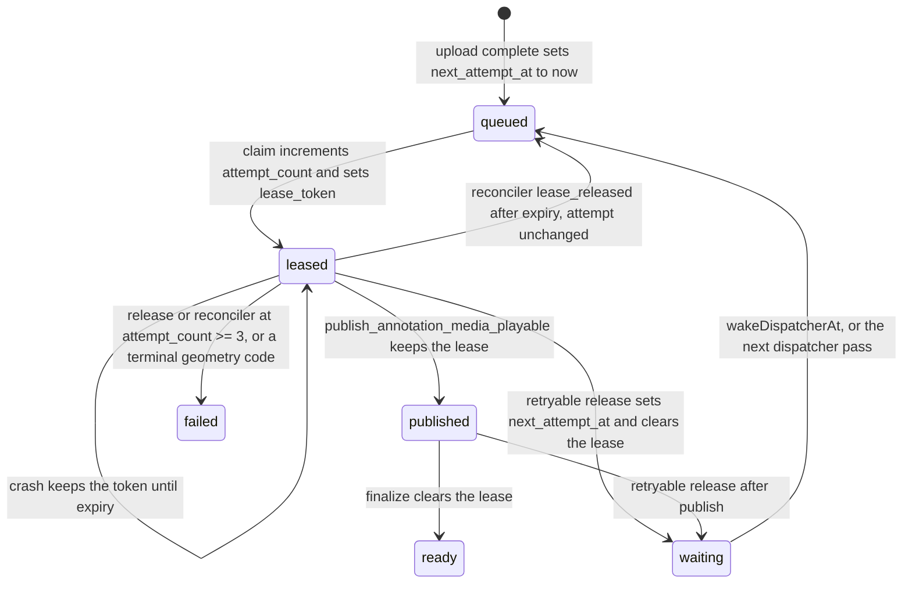

# Verify the media job lease

A hosted media job must not be processed by two workers at once, and every job must reach ready/published or failed without `attempt_count` passing 3. Tests hit one worker and one database. They do not interleave two dispatchers, a crash, and lease expiry. This skill checks those orders with TLC.

TLA+ is the tool because the question is whether steps can happen in a bad order. TLC 1.7.4 explores the model. A code-level verifier would not see two worker processes and the claim row lock.

## When a change touches this

Read the diff. The check covers these files and functions:

- `supabase/migrations/20261004020000_publish_playable_excerpt.sql`
  - `private.claim_annotation_media_processing`
  - `private.release_annotation_media_processing_attempt`
  - `private.list_annotation_media_dispatch_candidates`
  - `private.publish_annotation_media_playable`
  - `private.stage_annotation_media_transcript`
- `supabase/migrations/20261021140000_reject_expired_media_lease.sql`
  - `private.confirm_annotation_media_raw_deleted`
  - `private.finalize_annotation_media_ready`
- `supabase/migrations/20260904220811_widen_derivative_duration_slack.sql`
  - `private.stage_annotation_media_derivative`
- `supabase/migrations/20260818170519_phase_c_worker_contract_v2.sql`
  - `private.reconcile_annotation_media_processing`
- `supabase/migrations/20260903020000_phase_f4_media_only_withdrawal.sql`
  - the processing branch of `private.list_annotation_media_reconciliation_candidates`
- `apps/media-worker/src/runtime/dispatcher.mjs` `runDispatchCycle`
- `apps/media-worker/src/runtime/dispatcher-wake.mjs` `wakeDispatcherAt`
- `apps/media-worker/src/runtime/reconciler.mjs` `runReconciliationCycle` for `lease_expired` and `attempts_exhausted`
- `apps/media-worker/src/runtime/worker-job.mjs` `runOneMediaJob`
- `apps/media-worker/src/entrypoint/main.mjs` worker timeout, dispatcher wake, and the startup error for a short lease
- `apps/media-worker/src/infrastructure/postgres-worker-store.mjs` `claim`, `releaseAttempt`, `reconcileProcessing`
- `apps/media-worker/src/runtime/config.mjs` `loadRuntimeConfig` lease-versus-timeout guard
- `apps/media-worker/src/runtime/cloud-run-dispatch.mjs` task timeout of 600 seconds
- `apps/web/src/app/api/media/upload/complete/route.ts` sets `next_attempt_at` when the upload is queued
- `apps/web/src/lib/media-dispatch-trigger.ts` `signalQueuedMediaDispatch`

If the diff does not touch any of these, skip the check. Storage cleanup, article publish, dispatch tokens, and transcript text are outside it.

## Properties

Mutual exclusion: a media job is never processed by two workers at once. The harm is two workers writing one excerpt, one of them with a stale lease.

Termination: every job eventually reaches ready/published or failed, and `attempt_count` never exceeds 3. The harm is a job stuck in processing, or a fourth attempt.

Publication is the success state. The transcript does not gate it. `attempt_count` is incremented in the claim, not in the release. The cap in the SQL is `attempt_count < 3` on claim and `attempt_count >= 3` on release and reconcile.

Two guards keep the overlap out of the running system. `loadRuntimeConfig` refuses to start unless the lease is greater than the worker lifetime plus 60 seconds. The lifetime is the smaller of the configured worker timeout and the 600 second Cloud Run task timeout. The defaults, 900 seconds and 600 seconds, pass. A 60 second lease does not. `confirm_annotation_media_raw_deleted` and `finalize_annotation_media_ready` reject `lease_expires_at <= now()`, the same comparison the other worker write RPCs use.

## Lifecycle



A worker crash is `process.exit` or a killed process with no successful release. The row keeps `lease_token` until the lease expires, the reconciler clears it, or a later claim replaces it. Startup will not boot a lease that can expire while that process is still allowed to run.

## Run

From the repository root:

```bash
bash .cursor/skills/verify-media-job-lease/spec/run-tlc.sh
```

The script needs Java 11 or newer and downloads TLC 1.7.4, sha256 `936a262061c914694dfd669a543be24573c45d5aa0ff20a8b96b23d01e050e88`. It runs four configs of `spec/MediaJobLifecycle.tla` one after another. Logs go under `/tmp/annotated-tlc/logs/`.

Exit 0 means mutual exclusion passes, termination passes, and both mutants are caught. Exit 1 means one of those results changed, or TLC itself failed.

| Config | What it is | Recorded result |
| --- | --- | --- |
| `MediaJobLifecycle.cfg` | The code that is allowed to start. The worker is dead before its lease expires. Confirm and finalize require an unexpired lease. | Pass |
| `MediaJobLifecycleTermination.cfg` | Same model. Termination and the attempt cap. | Pass |
| `MutantSkipLease.cfg` | Separate config. Claim skips the lease recheck. | Counterexample for mutual exclusion |
| `MutantNoIncrement.cfg` | Separate config. Claim does not increment `attempt_count`. | Counterexample for termination |

Bounds on every config: 2 workers (`w1`, `w2`), 2 jobs (`j1`, `j2`), max attempts 3. The real model has 95,649 distinct states (363,517 generated). The mutex run and the termination run both walk that graph. The skip-lease mutant stops at 58 distinct states (88 generated). The no-increment mutant stops at 13,991 distinct states (53,817 generated). Those smaller counts are the search up to the counterexample, not a second model size.

Do not edit product code from this skill. The mutants are constants in the configs (`CheckLease`, `IncrementAttempt`). They are not a patch to the SQL.

## Recorded result

Mutual exclusion passes. Termination passes. `attempt_count` stays at most 3.

The real configs set `ExpireWhileRunning` false. That is the startup guard: `loadRuntimeConfig` throws, and the process exits 1, unless `leaseSeconds` is greater than `min(worker timeout seconds, 600) + 60`. A 60 second lease is not a configuration this model is allowed to start. The old overlap, a 60 second lease against a 600 second task, is the setting the guard rejects. It is not a state of `MediaJobLifecycle.cfg`.

Confirm and finalize both require `~expired`. That is `lease_expires_at > now()` in `supabase/migrations/20261021140000_reject_expired_media_lease.sql`. With the startup guard, a running holder is already gone before expiry, so this check does not create the mutual-exclusion result. It stops a stale worker from confirming raw deletion or clearing the lease after `lease_expires_at`.

Fairness used for termination: a running worker eventually takes some step (progress, retryable failure, terminal failure, crash, or drop); a due listed job is eventually dispatched to an idle worker; a waiting `next_attempt_at` eventually becomes due; an expired or exhausted processing row is eventually reconciled; a requested wake eventually runs. Fairness does not require the worker to succeed. Crashes and retryable failures are allowed, and the attempt cap is what ends those behaviors.

## Mutants

`MutantSkipLease.cfg` sets `CheckLease` false. TLC reports mutual exclusion violated:

1. Both jobs are queued with no lease.
2. One dispatcher starts `w1` for `j1`.
3. Another dispatcher starts `w2` for `j1` before either claim.
4. `w1`'s claim commits. `attempt_count` is 1 and the lease is unexpired. `w1` is processing.
5. `w2`'s claim also commits, without rechecking the lease. `attempt_count` is 2. Both workers are processing `j1`.

`MutantNoIncrement.cfg` leaves the lease check in place and does not increment `attempt_count`. TLC reports termination violated. One fair loop is: claim `j1` with `attempt_count` stuck at 0, stage the derivative, confirm raw deletion, hit a retryable failure, wait until `next_attempt_at`, claim again at 0, and repeat. The other job can reach failed. `j1` never reaches ready/published or failed. The real release path does not increment either; the increment is the claim. Removing that increment is the broken retry budget.

## A real bug versus a modeling error

A counterexample on `MediaJobLifecycle.cfg` or `MediaJobLifecycleTermination.cfg` is a bug when every step names a function in the coverage list and the predicate TLC used is the predicate in that function. Report it. Do not weaken the property. Do not set `ExpireWhileRunning` true on those configs: that overlap is the setting `loadRuntimeConfig` refuses to start. Do not change product code unless the user asks.

A counterexample is a modeling error when a step cannot happen in the code: a second claim while the lease is unexpired and `CheckLease` is still true, an attempt increment on the release, confirm or finalize after expiry, or a reconciler failure of an already published row. Fix the spec in this directory, then rerun. A mutant that passes is a blind check. Fix the spec or the config, not the mutant's intent.

## Bounds and what is left out

Checked: 2 workers, 2 jobs, attempt cap 3, one lease token per job, the claim recheck under the row lock, crash without release, lease expiry after the holder is gone, reconciler `lease_released` and `attempts_exhausted`, retryable release, terminal geometry failure before publish, the worker wake plus a later dispatcher pass, and an unexpired-lease check on confirm and finalize.

Not checked, because the model does not contain them:

- The 72-hour processing deadline and a capture `version` other than 2 (`recapture_required`).
- Backoff seconds and the 0–30 second jitter. The model only keeps "not due yet" versus "due". The real delay for attempts 1 and 2 is at most 150 seconds, inside the 180 second wake window, so the wake is not skipped for length.
- Dispatcher list limit 25 and concurrency 8. The model has 2 and 2.
- More than two jobs, or two media rows on one annotation.
- Byte-level derivative, raw object, and transcript validation. `confirm_annotation_media_raw_deleted` is one step, not the storage list retry.
- The numeric comparison inside `loadRuntimeConfig`. The model records its result as `ExpireWhileRunning = FALSE`. The unit test is what shows a 60 second lease cannot start.
- Cleanup of removed, abandoned, and failed storage objects.
- Article annotations, dispatch-token forgery, and Cloud Run HTTP failures other than "the wake call failed, so the later dispatcher pass has to do it".
- A published row whose transcript never lands after `attempt_count` reaches 3. Termination treats publish as done, which matches the product rule that the transcript does not gate publication.

## Sync

Code this model describes: `a5fefbfe0e8308ceddec114cd3a1e1f73b392f97`.

Move that commit forward only after you have read the diff of every covered file from that commit to the new one, updated the spec so each action is still one indivisible step of the new code, and rerun `run-tlc.sh`. A pass on the old spec is not a pass on the new code. Use `/maintain-formal-verification-skill` when the covered code changed and this check was not rerun.
